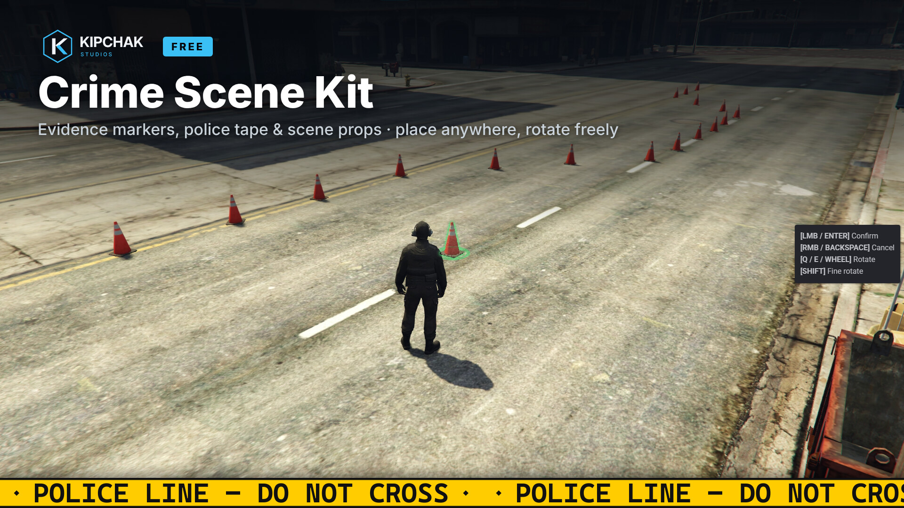
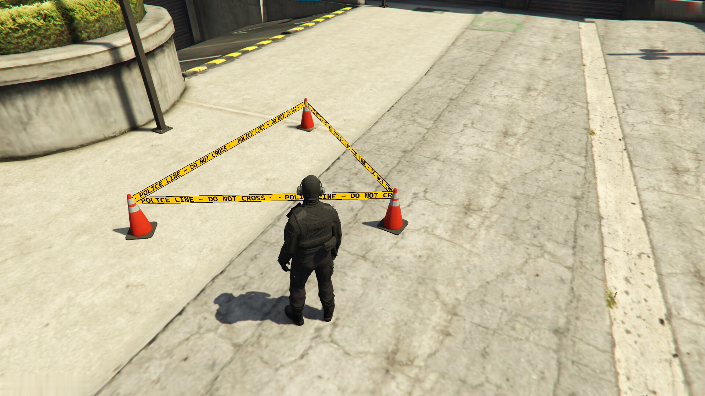
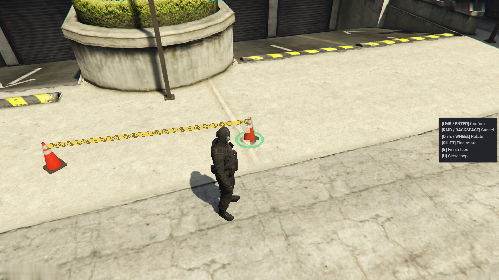
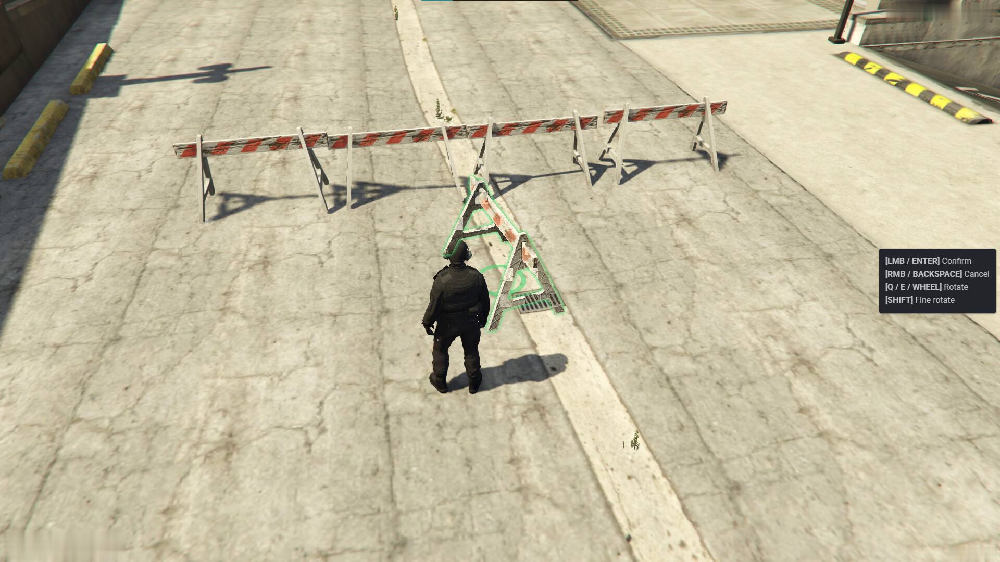
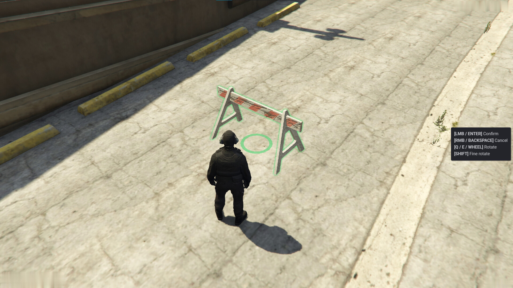
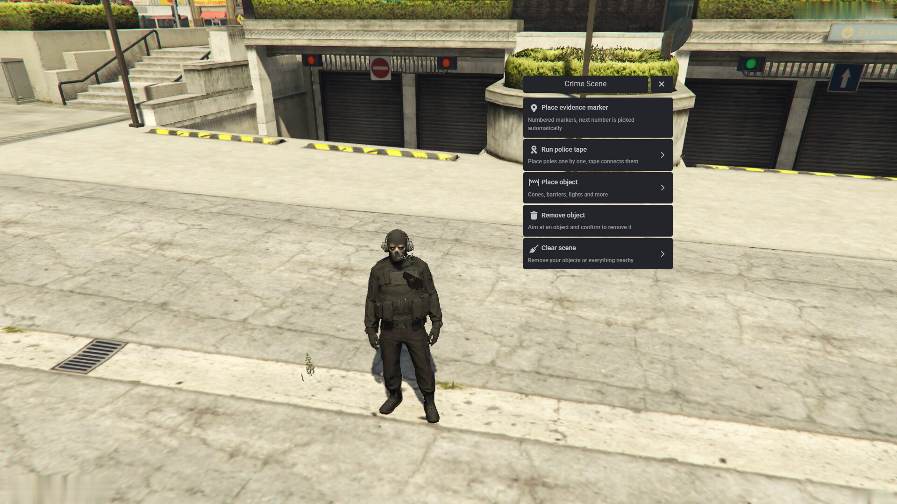

# Kipchak Crime Scene



**[Download on Tebex](https://kipchak.tebex.store)** · **[Discord](https://discord.gg/jfaacuje8f)** · **[Calibrix – Forensic Ballistics Lab](https://kipchak.tebex.store)**

A free, lightweight crime scene tool for FiveM by **Kipchak Studios**. Officers can lay numbered evidence markers, run police tape between poles and drop scene props such as cones, barriers and work lights. Every placement uses a transparent preview (ghost) that follows your aim, so you can position and rotate before confirming.

## Screenshots

| Police tape perimeter | Tape placement preview |
| --- | --- |
|  |  |
| **Barrier line** | **Barrier placement preview** |
|  |  |



## Features

- Shared ghost placement for markers, tape poles and props: follows the camera, snaps to the ground, rotates with Q/E or the mouse wheel, Shift for fine rotation
- Invalid spots (too far, in the air, on water, on walls) turn the preview red and block confirmation
- Numbered evidence markers that count per scene (1, 2, 3...), chain placement without reopening the menu
- Optional short notes on markers ("9mm casing", "blood trace"), shown under the number up close
- Officer name and time shown when standing next to a marker
- Police tape drawn between poles with a custom texture, visible from both sides, with a live preview of the next segment
- Three tape styles out of the box: `police`, `crime_scene` and Turkish `polis_tr`
- Remove mode that highlights the object you aim at, plus optional ox_target / qb-target options
- Clear your own objects, or everything in a radius with enough rank (`/clearscene [radius]`)
- Objects are local and streamed per client (no networked entities), new players receive the current list
- Auto expiry and optional persistence across restarts with KVP (no database tables)
- Server side validation for permissions, distance, model allow list, limits, cooldown and rate limit
- Optional Discord logs
- Qbox, QBCore and ESX with automatic detection
- English and Turkish locales
- Every feature can be toggled in `config.lua`

## Dependencies

- [ox_lib](https://github.com/overextended/ox_lib)
- One of: `qbx_core`, `qb-core`, `es_extended`
- Optional: `ox_target` or `qb-target`
- OneSync (default on modern servers)

## Installation

1. Put `kipchak_crimescene` in your resources folder.
2. Add it to `server.cfg` after ox_lib, your framework and your target resource:

```cfg
ensure ox_lib
ensure qbx_core
ensure ox_target
ensure kipchak_crimescene
```

3. Adjust `config.lua` (jobs, grades, limits) and, if you want Discord logs, put your webhook in `server/sv_config.lua` and set `Config.Logs.Enabled = true`.

## Usage

- `/scene` opens the menu (command name in `Config.Commands.Menu`).
- A keybind is registered as "Open crime scene menu". It has no default key, players can bind it in Settings > Key Bindings > FiveM. Set `Config.Keybind.Key` to give it a default.
- `/clearscene [radius]` clears everything within the radius around you (needs `Config.Permissions.ClearSceneGrade`).

## Controls

All controls can be changed in `Config.Placement.Controls` (control ids) and `Config.Placement.KeyLabels` (text shown in the help box).

| Action | Default |
| --- | --- |
| Confirm placement | Left mouse / Enter |
| Cancel / exit | Right mouse / Backspace |
| Rotate | Q / E, mouse wheel |
| Fine rotation | Hold Shift |
| Finish tape | G |
| Close tape loop (last pole to first) | H |
| Edit note in remove mode | G |

## Configuration

| Option | Description |
| --- | --- |
| `Config.Framework` | `'auto'`, `'qbox'`, `'qbcore'` or `'esx'` |
| `Config.Locale` | `'en'` or `'tr'` |
| `Config.AllowedJobs` | Job name to minimum grade, e.g. `{ police = 0, sheriff = 0 }` |
| `Config.RequireOnDuty` | Require the player to be on duty |
| `Config.Permissions.RemoveOthersGrade` | Minimum grade to remove or edit objects placed by others |
| `Config.Permissions.ClearSceneGrade` | Minimum grade to clear an area |
| `Config.Permissions.MaxClearRadius` | Upper limit for area clearing |
| `Config.Permissions.InteractDistance` | Max distance to remove or edit an object |
| `Config.Permissions.AdminAce` | Ace that grants full access regardless of job |
| `Config.Commands` | Enable and rename `/scene` and `/clearscene` |
| `Config.Keybind` | Enable the keybind and set an optional default key |
| `Config.Menu` | Toggle each menu entry: `Marker`, `Tape`, `Props`, `Remove`, `Clear` |
| `Config.Target` | Target support (`System = 'auto'`, `'ox'` or `'qb'`) and which options to show |
| `Config.Placement.MaxDistance` | Max distance between player and preview (default 8.0) |
| `Config.Placement.ChainPlacement` | Keep placing after each confirm until cancelled |
| `Config.Placement.MaxSlope` | Steepest surface angle accepted, in degrees |
| `Config.Markers.Model` / `Models` | Marker model, or per number models |
| `Config.Markers.Notes` | Notes on/off, ask on placement, max length, view distance |
| `Config.Markers.Info` | Officer and time text near a marker |
| `Config.Scene.Radius` | Scene radius used for marker numbering (default 60.0) |
| `Config.Scene.ExpireMinutes` | Auto removal after this many minutes, `0` disables |
| `Config.Tape.PoleModel` | Model used for tape poles |
| `Config.Tape.Height` | Tape height above the ground, or `'auto'` for the top of the pole |
| `Config.Tape.Thickness` | Tape width in meters |
| `Config.Tape.DrawDistance` | Tape is only drawn within this distance |
| `Config.Tape.MaxSegment` | Max distance between two poles |
| `Config.Tape.Styles` | Tape styles: label, texture, tint color and alpha |
| `Config.Props` | Props in the "Place object" list (label, model, icon) |
| `Config.Streaming` | Spawn distance and check interval for local objects |
| `Config.Limits` | Per player, per scene and total limits, cooldown and rate limit |
| `Config.Persistence` | Keep objects across restarts with KVP |
| `Config.Logs` | Discord logs, webhook lives in `server/sv_config.lua` |

## Using your own props

The defaults only use base game models. If your server streams its own evidence marker props, point the config at them:

```lua
Config.Markers.Model = 'my_evidence_marker'

Config.Markers.Models = {
    [1] = 'my_evidence_marker_01',
    [2] = 'my_evidence_marker_02',
    [3] = 'my_evidence_marker_03'
}
```

Numbers without an entry in `Models` fall back to `Model`. The number is always drawn as 3D text as well, so plain props work fine.

Tape poles and scene props work the same way through `Config.Tape.PoleModel` and `Config.Props`. Only models listed in the config are accepted by the server.

### Custom tape text

Tape textures are PNG files in `textures/`. To make a new one, run the included generator (Python 3 with Pillow):

```bash
python tools/generate_tape.py --name tape_custom --text "SHERIFF LINE - DO NOT CROSS" --bg FFCC00 --fg 111111
```

Then add a style:

```lua
Config.Tape.Styles.sheriff = { label = 'Sheriff Line', texture = 'tape_custom', color = { 255, 255, 255 }, alpha = 255 }
```

`color` is a tint multiplied with the texture, `{ 255, 255, 255 }` keeps the original colors.

## Integrations

The resource exposes a small server side API so other resources (for example Calibrix in a future update) can read evidence markers.

### Exports

```lua
local markers = exports.kipchak_crimescene:GetMarkers(vector3(441.0, -982.0, 30.7), 30.0)
for _, marker in ipairs(markers) do
    print(marker.id, marker.number, marker.coords, marker.note, marker.owner, marker.ownerName, marker.time, marker.sceneId)
end

local marker = exports.kipchak_crimescene:GetMarker(12)

local scene = exports.kipchak_crimescene:GetSceneAt(GetEntityCoords(GetPlayerPed(source)))
if scene then
    print(scene.id, scene.center)
end
```

| Export | Returns |
| --- | --- |
| `GetMarkers(coords, radius)` | Array of markers within the radius, sorted by scene and number |
| `GetMarker(id)` | One marker or `nil` |
| `GetSceneAt(coords)` | `{ id, center }` of the closest active scene within `Config.Scene.Radius`, or `nil` |

A marker is `{ id, number, coords, note, owner, ownerName, time, sceneId }`. `owner` is the framework identifier (citizenid or ESX identifier), `time` is a unix timestamp.

### Events

These are server only events fired with `TriggerEvent`. Listen with `AddEventHandler` (not `RegisterNetEvent`) so clients cannot fake them.

```lua
AddEventHandler('kipchak_crimescene:markerPlaced', function(marker, src)
end)

AddEventHandler('kipchak_crimescene:markerRemoved', function(marker, reason, src)
end)

AddEventHandler('kipchak_crimescene:sceneCleared', function(data, src)
end)
```

- `markerRemoved` reason is `'removed'`, `'cleared'` or `'expired'` (`src` is `nil` for expiry). It also fires for every marker removed by a clear.
- `sceneCleared` data is `{ mode = 'own' | 'radius', sceneIds, count, owner, coords?, radius? }`.

## Support

- Discord: https://discord.gg/jfaacuje8f
- Store: https://kipchak.tebex.store
- Looking for a full forensics workflow? Check out **Calibrix** on our store.

## License

MIT, see `LICENSE`. Open source, no escrow.
